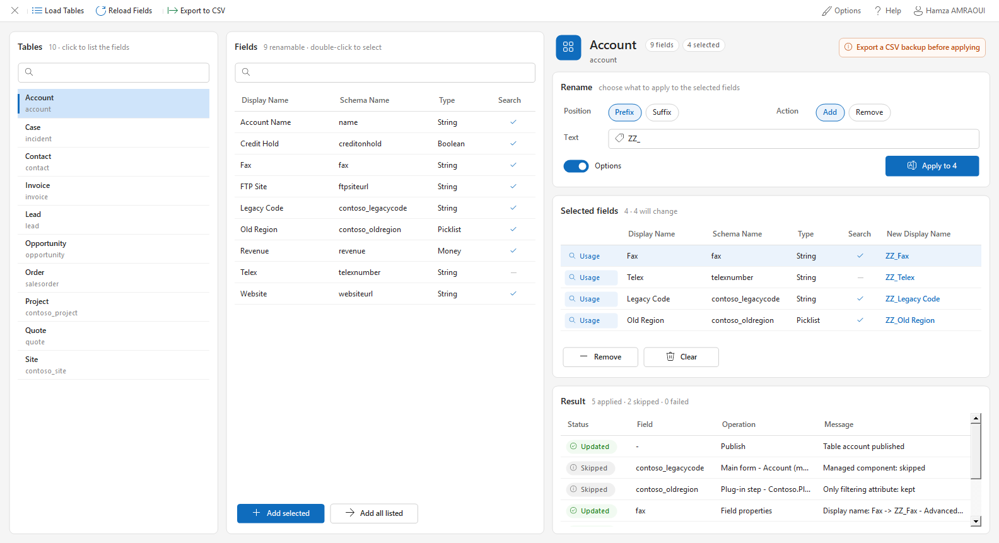
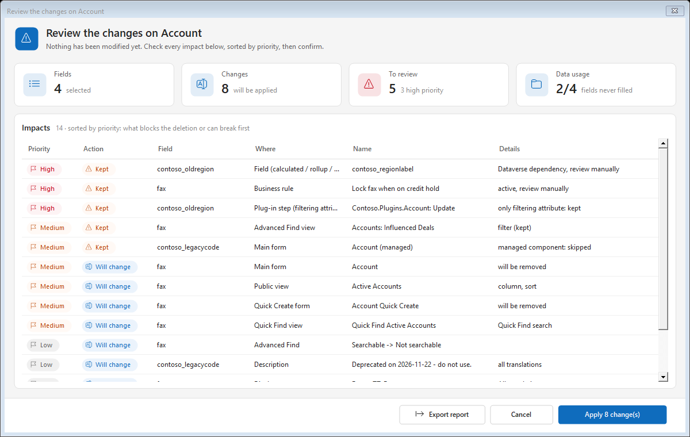
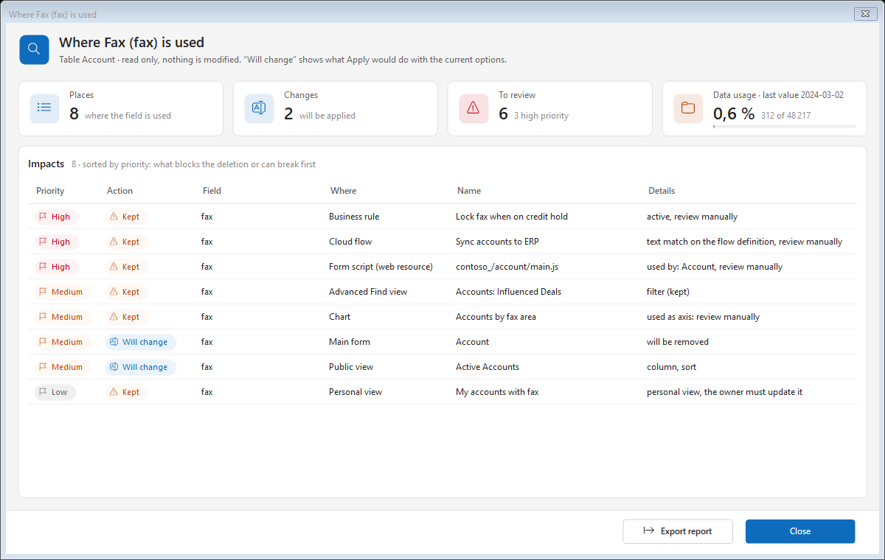
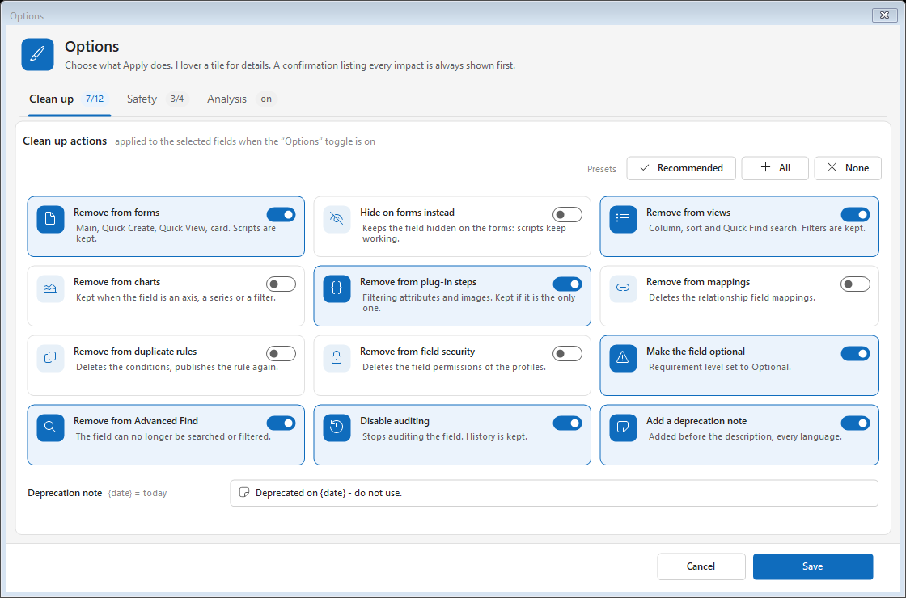
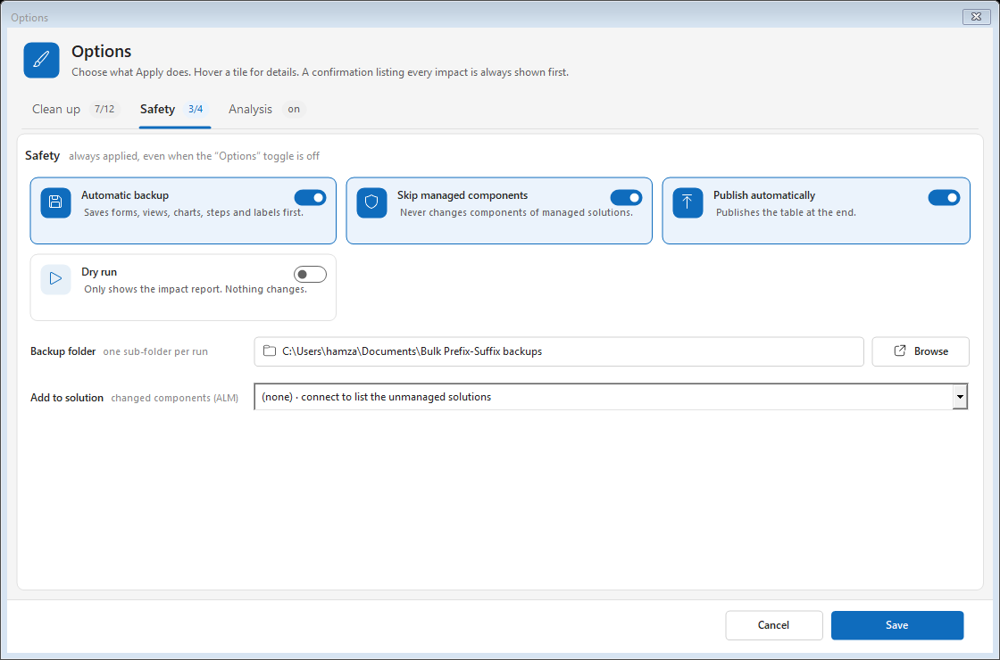

<div align="center">

# 🏷️ Bulk Prefix/Suffix Fields Name

**An XrmToolBox tool to retire deprecated Dynamics 365 / Dataverse fields, safely.**

*Tags fields in bulk. Finds every place they are used. Cleans them up after you review every impact.*

[](https://www.nuget.org/packages/BulkPrefixSuffixFieldsName)
[](https://www.nuget.org/packages/BulkPrefixSuffixFieldsName)
[](https://www.xrmtoolbox.com)
[](https://learn.microsoft.com/power-apps/developer/data-platform/)
[](https://mit-license.org/)

**XrmToolBox → Tool Library → “Bulk Prefix/Suffix Fields Name”**



</div>

---

## What it does

Deleting a field that is still used breaks forms, views, plug-ins and flows. The safe path is: **tag it, clean it up, check, then delete**. This tool does the first three for a whole batch of fields.

| | |
|---|---|
| 🏷️ **Tags in bulk** | Adds or removes a prefix or suffix (`ZZ_`, `[Deprecated]`…) on the display name, in **every language**, with a live preview. No double prefix, case-insensitive. |
| 🔍 **Finds every usage** | Forms, views, charts, plug-in steps and images, business rules, workflows, cloud flows, form scripts, calculated / rollup fields, keys, relationships, mappings, duplicate rules, field security, e-mail templates, personal views. |
| 🚦 **Sorts by priority** | What blocks the deletion or can break code comes first (**High**), then UI and configuration (**Medium**), then personal items and properties (**Low**). |
| 🧹 **Cleans up** | Removes (or hides) the fields on forms, views, charts, plug-in steps, mappings, duplicate rules and field security; makes them optional; removes them from Advanced Find; disables auditing; adds a dated deprecation note. |
| 📊 **Shows data usage** | How many records hold a value and when the most recent one was modified. `0 %` = a good candidate for deletion. |
| 🛡️ **Asks first** | A review window lists every impact before anything is written. Dry run, automatic backup, managed components skipped. |
| 📦 **ALM friendly** | Publishes the table (optional) and adds every changed component to the solution of your choice. |

---

## How it works

```
 Load tables ──► Pick fields ──► Prefix / suffix + Options ──► Impact analysis
                                                                     │
 Result ◄── Publish ◄── Solution ◄── Clean up ◄── Backup ◄── ✋ You approve
```

| Step | What happens | Your role |
|---|---|---|
| **1. Select** | Click a table, select the fields (multi-select, search, *Add all listed*) | **Pick the fields** |
| **2. Configure** | Prefix / Suffix, Add / Remove, text; switch on **Options** for the clean up | **Choose** |
| **3. Analyse** | Every place the fields are used, sorted by priority, with data usage | — |
| **4. Review** | What will change, what is kept and why; export the report | **Approve / cancel** |
| **5. Apply** | Backup, clean up, field properties, solution, publish | — |
| **6. Result** | One line per operation, with the Dataverse message on failure | — |

> **Nothing is written before you approve the review.** Use *Dry run* to only get the report.

---

## Review every impact

The **Usage** button in front of each selected field shows where it is used, at any time. **Apply** shows the same analysis for all the selected fields before any change.





---

## Options

Clean up actions apply when the **Options** toggle of the *Rename* card is on. Safety and analysis settings always apply. Presets: *Recommended*, *All*, *None*.



| Option | What it does | Guard rail |
|---|---|---|
| Remove from forms | Main, Quick Create, Quick View, card, header | Primary name field never removed, scripts kept |
| Hide on forms instead | Field stays on the form, hidden | Scripts keep working |
| Remove from views | Column, sort, Quick Find search | **Filters kept** |
| Remove from charts | Plain columns | Kept when axis, series or filter |
| Remove from plug-in steps | Filtering attributes and Pre/Post images | Kept when it is the only attribute |
| Remove from mappings | Deletes the relationship mappings | System mappings kept |
| Remove from duplicate rules | Deletes the conditions, publishes the rule again | Only condition → rule unpublished |
| Remove from field security | Deletes the field permissions | — |
| Make the field optional | Requirement level → Optional | System required kept |
| Remove from Advanced Find | Not searchable anymore | — |
| Disable auditing | Stops auditing | History kept |
| Add a deprecation note | `Deprecated on {date} - do not use.` before the description | Never added twice |



| Safety | |
|---|---|
| **Automatic backup** | Field labels, forms, views, charts, plug-in steps and images saved in a timestamped folder. If the backup fails, nothing is changed. |
| **Skip managed components** | Never creates unmanaged layers on managed forms, views, charts or steps. |
| **Publish automatically** | Or publish yourself later. |
| **Dry run** | Only the report, nothing is ever changed. |
| **Add to solution** | Changed components added to an unmanaged solution. |

---

## Install

**From XrmToolBox:** *Tool Library* → search **Bulk Prefix/Suffix Fields Name** → *Install*.

**Manually:** copy `BulkPrefixSuffixFieldsName.dll` to `%APPDATA%\MscrmTools\XrmToolBox\Plugins` and restart XrmToolBox.

---

## Requirements

| | |
|---|---|
| [XrmToolBox](https://www.xrmtoolbox.com) | 1.2020.12 or later |
| A connection | Dynamics 365 / Dataverse (online or on-premises) |
| Privileges | System Customizer on the table, its forms, views and plug-in steps |

---

## Things to know

- Only renamable fields are listed.
- Processes, flows, scripts and templates are found by searching the field name in their definition: review them manually.
- Personal views and charts are reported, not changed: their owner must update them.
- Data usage is not counted above 50,000 records (Dataverse aggregate limit).
- Run it on a development environment first, and deploy with your solution.

---

## Build

```powershell
msbuild "Bulk Prefix-Suffix Attribues Name.sln" /restore /p:Configuration=Release
```

| Folder | Content |
|---|---|
| `Prefix-Suffix Fields Name/Manager` | Engine: rename, impact analysis and clean up (`UsageManager`), backup |
| `Prefix-Suffix Fields Name/UI` | Fluent theme, controls, option tiles, Options and review dialogs |
| `Prefix-Suffix Fields Name/MyPluginControl.cs` | The XrmToolBox screen |

In Debug, the build copies the DLL to `%APPDATA%\MscrmTools\XrmToolBox\Plugins` and F5 starts `C:\XrmToolBox\XrmToolBox.exe`.

---

<div align="center">

**[NuGet](https://www.nuget.org/packages/BulkPrefixSuffixFieldsName)** · **[Issues](https://github.com/AmraouiH/Prefix-Suffix-Fields-Name/issues)** · **[Hamza AMRAOUI](https://www.linkedin.com/in/hamza-amraoui/)**

MIT © 2026

</div>
